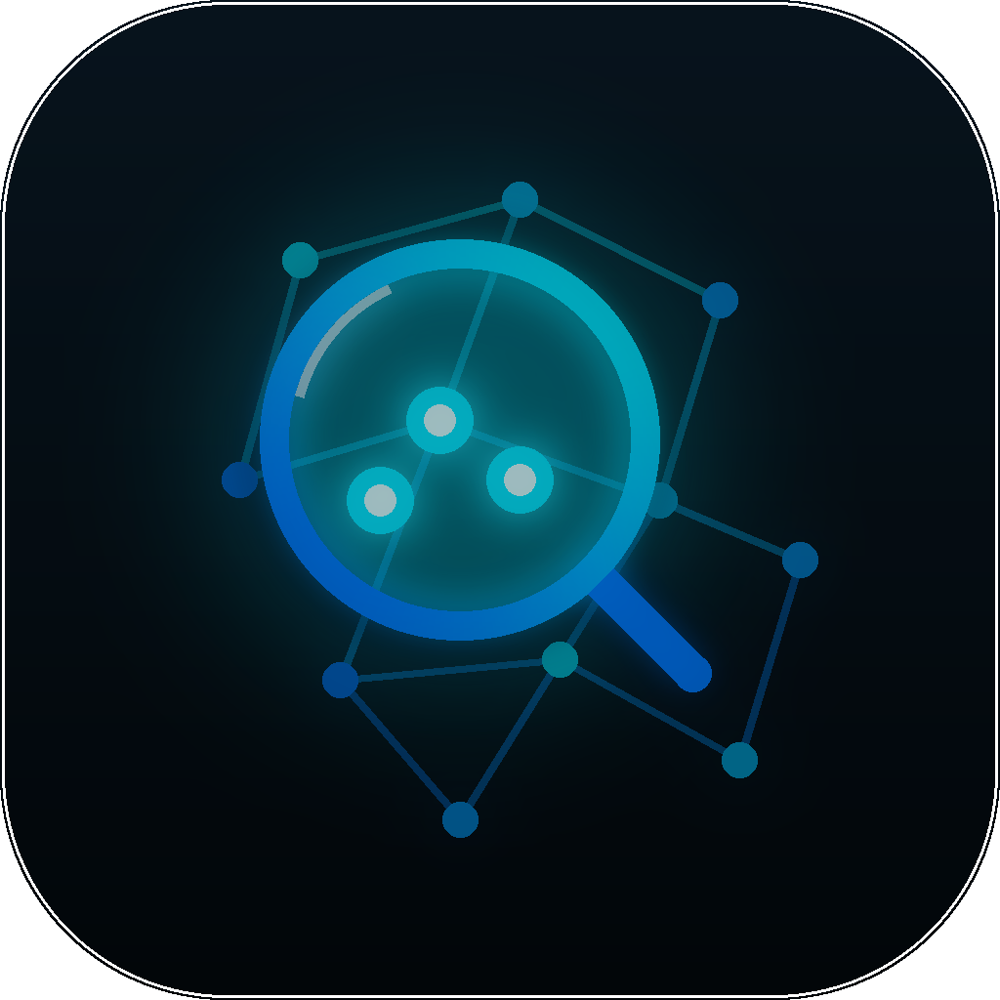

  

<h1 align="center">Net-Analyzer Scanner for macOS</h1>

Sieh jedes Gerät in deinem Netzwerk — direkt aus der Menüleiste deines Macs. Herstellerkennung, Wake-on-LAN, Warnungen bei neuen Geräten und integrierte Netzwerk-Tools.

  
  
  
  

🌍 <a href="README.es.md">🇪🇸 Español</a> · <a href="README.md">🇬🇧 English</a> · <strong>🇩🇪 Deutsch</strong> · <a href="README.fr.md">🇫🇷 Français</a> · <a href="README.it.md">🇮🇹 Italiano</a> · <a href="README.pt.md">🇵🇹 Português</a>

> **Dieses Repository veröffentlicht ausschließlich offizielle Binär-Releases** — der Quellcode ist privat. Signierte Downloads, Prüfsummen und Auto-Update-Feeds.

## Download

| | |
|---|---|
| 📥 **Vollversion** | [Neuestes DMG laden](https://github.com/mavksoft/scanner-macos-releases/releases/latest) — signiert & notarisiert |
| 🍎 **Mac App Store** | [Net-Analyzer — Netzwerk-Scanner](https://apps.apple.com/es/app/net-analyzer-esc%C3%A1ner-de-red/id6746715754) |
| 🌍 **Website** | [scanner.net-analyzer.com](https://scanner.net-analyzer.com) |

## Was ist das

Net-Analyzer Scanner ist eine leichte Menüleisten-App, die die Frage "Was hängt an meinem WLAN?" in Sekunden beantwortet: Sie findet jedes Gerät im LAN, nennt den Hersteller und warnt, wenn etwas Neues auftaucht.

   

## Funktionen

- **Vollständige Geräteerkennung** — Bonjour, SSDP, TCP, ARP, NDP, SNMP und SMB finden alles im LAN.
- **Herstellerkennung** — die OUI-Datenbank verrät, wer jedes Gerät gebaut hat (Router, Handy, Kamera, IoT…).
- **Warnung bei neuen Geräten** — Benachrichtigung, wenn sich etwas Unbekanntes verbindet.
- **Wake-on-LAN** — Rechner aus der Ferne mit einem Klick aufwecken.
- **Router-Audit** — Sicherheitschecks gegen dein Gateway.
- **Netzwerk-Tools** — Ping, Port-Scan, Verlauf und Notizen pro Gerät.
- **Für die Menüleiste gebaut** — eine leichte SwiftUI-App, die in der Menüleiste lebt.
- **Sechs Sprachen** — ES / EN / FR / IT / DE / PT, mit remote verwalteten Updates.

## So wird es verwendet

1. DMG laden, App nach Programme ziehen und öffnen.
2. Das Symbol sitzt in der Menüleiste — klicken und einen Scan starten.
3. Nach Sekunden siehst du die Geräteliste: Name, IP, MAC und Hersteller.
4. Warnungen aktivieren, um über neue Geräte informiert zu werden.
5. Wake-on-LAN, Ping oder Port-Scanner direkt aus der Gerätekarte nutzen.

## Voraussetzungen

Aktuelles macOS · Apple Silicon & Intel (Universal Binary) · Von Apple signiert und notarisiert.

## Was dieses Repository enthält

- `Scanner-Net-Analyzer-<Version>.dmg` — signiertes + notarisiertes Installationsprogramm
- `Scanner-Net-Analyzer-<Version>.zip` — Sparkle-Update-Archiv (EdDSA-signiert) für den In-App-Updater
- Die App-Store-Edition wird über den App Store selbst aktualisiert.

[Neueste Version](https://github.com/mavksoft/scanner-macos-releases/releases/latest)

## Häufige Fragen

**Warum sehe ich "unbekannte" Geräte?**  
Viele Geräte melden weder Namen noch Dienste. Der MAC-Hersteller (OUI) verrät meist die Antwort — suche nach "Apple", "Espressif" (IoT), "Samsung"…

**Kann es einen ausgeschalteten PC aufwecken?**  
Ja, wenn Wake-on-LAN im BIOS/System aktiviert ist und das Gerät im selben Netz hängt (bzw. entsprechend konfiguriert ist).

**Unterschied zwischen DMG und App-Store-Version?**  
Gleiche App; das DMG aktualisiert sich per Sparkle, die App-Store-Edition über Apple und läuft in der Sandbox.

## Support

- Website: [scanner.net-analyzer.com](https://scanner.net-analyzer.com)
- E-Mail: [support@it-systems.es](mailto:support@it-systems.es)

---

Net-Analyzer Scanner for macOS · © MavkSoft / IT-Systems

