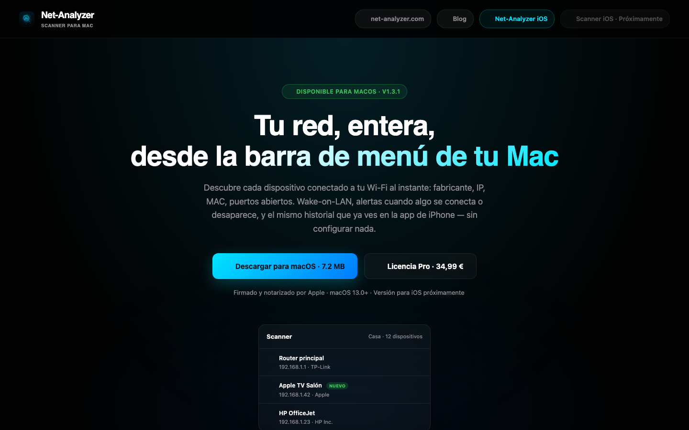
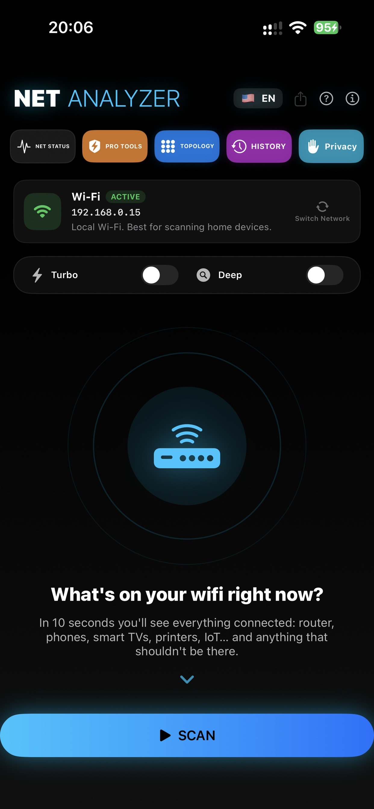
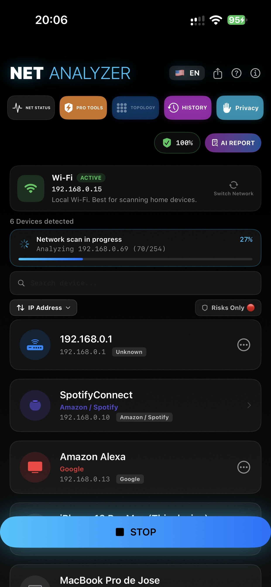
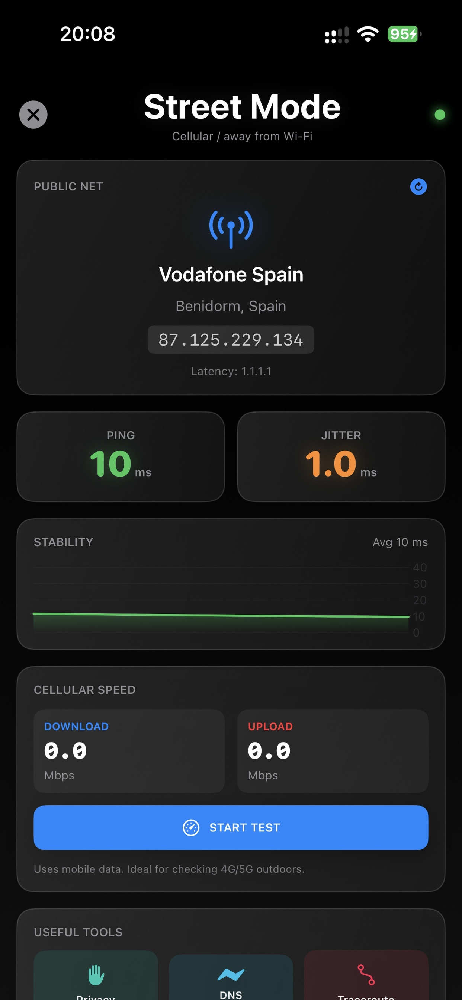

  

<h1 align="center">Net-Analyzer Scanner for macOS</h1>

Veja todos os dispositivos da sua rede — diretamente da barra de menus do Mac. Identificação de fabricante, Wake-on-LAN, alertas de novos dispositivos e ferramentas de rede integradas.

  
  
  
  

🌍 <a href="README.es.md">🇪🇸 Español</a> · <a href="README.md">🇬🇧 English</a> · <a href="README.de.md">🇩🇪 Deutsch</a> · <a href="README.fr.md">🇫🇷 Français</a> · <a href="README.it.md">🇮🇹 Italiano</a> · <strong>🇵🇹 Português</strong>

> **Este repositório publica apenas releases binários oficiais** — o código-fonte é privado. Downloads assinados, checksums e feeds de atualização automática.

## Transferir

| | |
|---|---|
|  **Versão completa** | [Descarregar o último DMG](https://github.com/mavksoft/scanner-macos-releases/releases/latest) — assinado e notarizado |
|  **Mac App Store** | [Net-Analyzer — Analisador de rede](https://apps.apple.com/es/app/net-analyzer-esc%C3%A1ner-de-red/id6746715754) |
|  **Site oficial** | [scanner.net-analyzer.com](https://scanner.net-analyzer.com) |

## O que é

O Net-Analyzer Scanner é uma app leve de barra de menus que responde em segundos a «o que está ligado ao meu Wi-Fi?»: descobre cada dispositivo da LAN, diz quem o fabricou e avisa quando aparece algo novo.

   

## Funcionalidades

- **Descoberta completa** — Bonjour, SSDP, TCP, ARP, NDP, SNMP e SMB encontram tudo na LAN.
- **Identificação de fabricante** — a base OUI diz quem fabricou cada dispositivo (router, telemóvel, câmara, IoT…).
- **Alertas de novos dispositivos** — receba um aviso quando algo desconhecido se liga à rede.
- **Wake-on-LAN** — acorde máquinas à distância com um clique.
- **Auditoria do router** — verificações de segurança contra o gateway.
- **Ferramentas de rede** — ping, scan de portas, histórico e notas por dispositivo.
- **Feita para a barra de menus** — uma app SwiftUI leve que vive na barra de menus.
- **Seis idiomas** — ES / EN / FR / IT / DE / PT, com atualizações geridas remotamente.

## Como usar

1. Descarregue o DMG, arraste a app para Aplicações e abra-a.
2. O ícone fica na barra de menus — clique e lance um scan.
3. Em segundos vê a lista de dispositivos: nome, IP, MAC e fabricante.
4. Ative os alertas para saber quando um novo dispositivo se liga.
5. Use Wake-on-LAN, ping ou o scanner de portas na ficha de cada equipamento.

## Requisitos

macOS recente · Apple Silicon e Intel (binário universal) · Assinado e notarizado pela Apple.

## O que contém este repositório

- `Scanner-Net-Analyzer-<versão>.dmg` — instalador assinado + notarizado
- `Scanner-Net-Analyzer-<versão>.zip` — arquivo de atualização Sparkle (assinado EdDSA) para o auto-updater
- A edição Mac App Store é atualizada pela própria App Store.

[Versão mais recente](https://github.com/mavksoft/scanner-macos-releases/releases/latest)

## Perguntas frequentes

**Porque vejo dispositivos "desconhecidos"?**  
Muitos equipamentos não anunciam nome nem serviços. O fabricante MAC (OUI) normalmente dá a resposta — procure "Apple", "Espressif" (IoT), "Samsung"…

**Consegue acordar um PC desligado?**  
Sim, se o Wake-on-LAN estiver ativo na BIOS/sistema e a máquina estiver na mesma rede (ou configurada para tal).

**Diferença entre o DMG e a App Store?**  
A mesma app; o DMG atualiza via Sparkle, a edição App Store via Apple e corre em sandbox.

## Suporte

- Site: [scanner.net-analyzer.com](https://scanner.net-analyzer.com)
- Email: [support@it-systems.es](mailto:support@it-systems.es)

---

Net-Analyzer Scanner for macOS · © MavkSoft / IT-Systems

